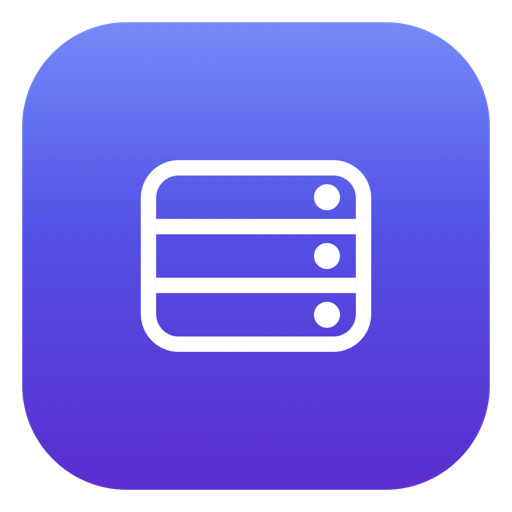

<p align="center">
  
</p>

<p align="center">
  <sub>One command for <b>nginx · Apache · PHP-FPM · MySQL · PostgreSQL · Redis · Mailpit</b> on macOS —<br>
  clean <code>*.test</code> URLs, real <code>.htaccess</code>, trusted HTTPS and a native control app.</sub>
</p>

<p align="center">
  <a href="#install"></a>
  <a href="https://brew.sh"></a>
  
  <a href="https://github.com/itsmeshafat/dev-stack/releases"></a>
  <a href="https://github.com/itsmeshafat/dev-stack/actions/workflows/ci.yml"></a>
  <a href="LICENSE"></a>
  <a href="https://github.com/itsmeshafat/dev-stack/stargazers"></a>
  <a href="https://github.com/itsmeshafat/dev-stack/pulls"></a>
</p>

<p align="center">
  <a href="#install"><b>Install</b></a> &nbsp;·&nbsp;
  <a href="#why-dev-stack">Why</a> &nbsp;·&nbsp;
  <a href="#how-it-works">How it works</a> &nbsp;·&nbsp;
  <a href="#configuration">Configuration</a> &nbsp;·&nbsp;
  <a href="#databases">Databases</a> &nbsp;·&nbsp;
  <a href="#commands">Commands</a> &nbsp;·&nbsp;
  <a href="#safety">Safety</a> &nbsp;·&nbsp;
  <a href="docs/INSTALL.md">Docs</a> &nbsp;·&nbsp;
  <a href="CHANGELOG.md">Changelog</a>
</p>

<p align="center">
  <sub><b>9 services</b> &nbsp;·&nbsp; <b>3 PHP versions</b> &nbsp;·&nbsp; <b>1 command</b> &nbsp;·&nbsp; <b>0 DNS daemons</b> &nbsp;·&nbsp; <b>0 containers</b></sub>
</p>

---

<p align="center">
  
  <br>
  <sub><b>The control app</b> — start, stop or restart the whole stack or a single module, with live status.</sub>
</p>

## Why dev-stack

|  |  |
|---|---|
| 🌐 **Clean URLs on one port** | Every site answers at `yourapp.test` on `:80` — no `:8000`, no `localhost/path`. |
| 🧩 **Real Apache underneath** | nginx fronts [Apache](https://httpd.apache.org) on `127.0.0.1:8081`, so `.htaccess` and `mod_rewrite` behave exactly as they do in production. |
| 🐘 **Three PHP versions, side by side** | 8.5, 8.3 and 7.4 — each site picks its own through dedicated php-fpm sockets. |
| 🚫 **No DNS daemon** | `*.test` names live in one managed `/etc/hosts` block, regenerated from your vhosts. No dnsmasq, nothing on port 53. |
| 🖥️ **Native control app** | A SwiftUI app for start/stop/restart and at-a-glance status. The CLI underneath is the single source of truth. |
| 🔒 **Trusted HTTPS** | One wildcard `*.test` certificate via [mkcert](https://github.com/FiloSottile/mkcert); `http://` 301s to `https://`. |
| 🛟 **Safe by design** | `--dry-run`, automatic config backups, an idempotent installer and a clean `uninstall.sh`. |
| 🧰 **Composer & WP-CLI included** | `devstack composer` runs with the PHP version the site declares. |

<details>
<summary><b>Why not a container or a bundled manager app?</b></summary>

<br>

| Approach | What you get |
|---|---|
| **Containers** (Docker, Colima) | Reproducible and isolated — but you pay for a VM, a different filesystem, and `.htaccess`/inotify/file-permission quirks you end up working around all day. |
| **Bundled manager apps** (Herd, FlyEnv, MAMP, …) | Genuinely convenient — but your stack lives inside a third-party app. Update it, or uninstall it, and your setup goes with it. |
| **Homebrew wired by hand** | Exactly the right ingredients, if you enjoy connecting nginx → Apache → php-fpm → hosts → certificates yourself. |
| **dev-stack** | Those same plain Homebrew services, on your real filesystem, wired together for you — plus clean URLs, real `.htaccess`, trusted HTTPS and a control app. |

Nothing here runs in a VM, and no project file is ever moved or copied: a site is one line pointing at a folder
you already have.

</details>

## Install

> Nothing changes until you run the installer. `--dry-run` prints every action and touches nothing.

**1 · Clone, inspect, run** — recommended:

```bash
git clone https://github.com/itsmeshafat/dev-stack.git
cd dev-stack

./install.sh --dry-run    # prints every action, changes nothing
./install.sh              # install (one password prompt, for the scoped helper)
```

Prefer to read it from the web first?

```bash
curl -fsSLO https://raw.githubusercontent.com/itsmeshafat/dev-stack/main/install.sh
less install.sh && bash install.sh --dry-run && bash install.sh
```

**2 · Add a site** — one line in `~/.config/devstack/sites.conf` (nothing is copied or moved):

```bash
$EDITOR ~/.config/devstack/sites.conf     # host | docroot | php | kind
devstack sync                             # regenerate vhosts + /etc/hosts, reload both servers
devstack doctor                           # verify services, configs, ports and every site
```

**3 · Start it** — either way works, and both drive the same CLI:

```bash
devstack start          # from a terminal
open "/Applications/Dev Stack.app"   # or click Start All in the app
```

Then it looks like this:

```console
$ devstack status
mysql     running   127.0.0.1:3306
postgres  running   127.0.0.1:5432
redis     running   127.0.0.1:6379
mail      running   smtp :1025 · ui :8025
php85     running   /tmp/devstack-php-85.sock
php83     running   /tmp/devstack-php-83.sock
php74     running   /tmp/devstack-php-74.sock
apache    running   127.0.0.1:8081
web       running   nginx :80 / :443

$ devstack sites
HOST            PHP   DOCROOT                 KIND
myapp.test      8.5   ~/Sites/myapp/public    laravel
blog.test       8.3   ~/Sites/blog            wp
legacy.test     7.4   ~/Sites/legacy          legacy
```

**Uninstalling** is symmetrical: `./uninstall.sh` stops the services, removes the helper and restores the
configuration backups it took.

## How it works

```text
                    ┌──────────── yourapp.test :80 ────────────┐
     browser ──────▶│ nginx  ($HOMEBREW_PREFIX/etc/nginx)      │
                    │   servers/<host>.conf → proxy_pass :8081 │
                    └────────────────────┬─────────────────────┘
                                         ▼
                    ┌────── Apache 127.0.0.1:8081 ─────────────┐
                    │ httpd/vhosts/<host>.conf                 │
                    │   AllowOverride All  → .htaccess/mod_rewrite
                    │   <FilesMatch \.php$> → proxy:unix:…      │
                    └────────────────────┬─────────────────────┘
                                         ▼
          /tmp/devstack-php-85.sock · -83.sock · -74.sock

  data   mysql@8.4 :3306 · postgresql@18 :5432 · redis :6379 · mailpit :1025/:8025
  DNS    /etc/hosts  →  127.0.0.1 <host>   (generated from nginx vhosts)
```

nginx is the **single public entry point**; Apache binds to **loopback only**, so nothing is exposed beyond
your machine other than the ports you already had open.

<details>
<summary><b>Modules and endpoints</b></summary>

<br>

| module | service | endpoint |
|---|---|---|
| `mysql` | `mysql@8.4` | `127.0.0.1:3306` |
| `postgres` | `postgresql@18` | `127.0.0.1:5432` |
| `redis` | `redis` | `127.0.0.1:6379` |
| `mail` | `mailpit` | SMTP `:1025` · UI `:8025` |
| `php85` | `php` | `/tmp/devstack-php-85.sock` |
| `php83` | `php@8.3` | `/tmp/devstack-php-83.sock` |
| `php74` | `php@7.4` | `/tmp/devstack-php-74.sock` |
| `apache` | `httpd` | `127.0.0.1:8081` |
| `web` | `nginx` | `:80` / `:443` |

</details>

> **💡 Tooling** — the installer also provisions **Composer** and **WP-CLI**. `devstack composer` runs with the
> PHP version a site declares, resolved from `sites.conf`:
> `devstack composer --site myapp.test -- install`, or simply `devstack composer install` from inside a project.

## Configuration

**`~/.config/devstack/sites.conf`** — one site per line, `|` separated (`kind` and `aliases` are optional):

```ini
# host            | docroot                              | php | kind    | aliases
casepilot.test    | ~/Developer/CasePilot                | 8.3 | laravel
jd-blog.test      | ~/Developer/jd-blog/public           | 8.5 | php
wptest.test       | ~/Sites/wptest                       | 8.5 | wp
myapp.test        | ~/Sites/myapp                        | 8.5 | laravel | www.myapp.test
```

**`~/.config/devstack/config`** — optional port overrides:

```ini
NGINX_PORT=80
APACHE_PORT=8081
```

> **Tip** — use `public/` as the docroot for a stock Laravel app. If the app ships a root `.htaccess` that
> forwards into `public/`, point the docroot at the project root instead.

## Adding a site

There is **no fixed web root** — a site is just one line.

```bash
devstack add-site        # interactive: host, docroot, php, kind
devstack sync            # regenerate vhosts + /etc/hosts, reload servers
devstack doctor          # verify everything
```

Or append the line yourself:

```ini
myapp.test | ~/Sites/myapp/public | 8.5 | laravel
```

**Which folder is the document root?**

| Project type | Docroot |
|---|---|
| Laravel / Symfony | `<project>/public` |
| WordPress | the folder containing `wp-config.php` |
| Plain PHP / legacy | the folder containing `index.php` |
| Root `.htaccess` forwarding into `public/` | the project root |

Pointing an **existing** project at the stack is that same single line — the `kind` column only controls what
`devstack ssl enable` rewrites (Laravel `APP_URL`, WordPress `siteurl`/`home`).

> **🖥️ In the app** — the **Help** button, or **Help → Dev Stack Help** (<kbd>⌘</kbd><kbd>?</kbd>), renders
> [`docs/HELP.md`](docs/HELP.md) in a window. The guide is bundled at build time, so app and docs stay in sync
> from one file.

## Databases

MySQL 8.4 (`:3306`), PostgreSQL 18 (`:5432`) and Redis (`:6379`) run as plain Homebrew services. dev-stack does
**not** create databases, users or passwords for you — and it never backs them up.

```sql
-- MySQL 8.4 — a fresh Homebrew install has no root password (`mysql -u root`); add -p if you set one
CREATE DATABASE myapp CHARACTER SET utf8mb4 COLLATE utf8mb4_0900_ai_ci;
CREATE USER 'myapp'@'localhost' IDENTIFIED BY 'STRONG-PASSWORD';
CREATE USER 'myapp'@'127.0.0.1' IDENTIFIED BY 'STRONG-PASSWORD';
GRANT ALL PRIVILEGES ON myapp.* TO 'myapp'@'localhost';
GRANT ALL PRIVILEGES ON myapp.* TO 'myapp'@'127.0.0.1';

-- PostgreSQL 18 — your macOS user is a superuser, and local connections are trusted
CREATE ROLE myapp LOGIN PASSWORD 'STRONG-PASSWORD';
CREATE DATABASE myapp OWNER myapp;
```

> **`localhost` and `127.0.0.1` are different accounts** to MySQL — `localhost` uses the socket, `127.0.0.1`
> uses TCP. Laravel connects over TCP while the `mysql` CLI usually uses the socket, so create both if you're
> unsure. Redis has no users and its "databases" are numbered keyspaces (`redis-cli -n 1`).

Creating users and databases, grants, `mysqldump`/`pg_dump` restores, resetting a forgotten MySQL root password
and every common error are in **[`docs/DATABASES.md`](docs/DATABASES.md)**.

Want a browser UI? It's opt-in:

```bash
devstack phpmyadmin install     # or: ./install.sh --phpmyadmin
```

That downloads the current phpMyAdmin, verifies the published SHA-256, installs it in `~/Sites/phpmyadmin` and
serves it at **https://phpmyadmin.test** (on PHP 8.3 — 5.2.x supports PHP `>=7.2,<8.4`). Authentication is
`cookie`, so no database password is ever stored, and an existing phpMyAdmin that dev-stack did not install is
never overwritten.

## Commands

| Command | What it does |
|---|---|
| `devstack status` | Show every module and its state |
| `devstack start \| stop \| restart [module]` | Control all modules, or one |
| `devstack sites` | List configured sites |
| `devstack add-site` | Add a site interactively |
| `devstack sync` | Regenerate vhosts and reload nginx + Apache |
| `devstack ssl {enable \| disable \| status \| renew}` | Toggle trusted HTTPS for all sites |
| `devstack phpmyadmin [status \| install]` | Optional phpMyAdmin at `https://phpmyadmin.test` |
| `devstack update [--check \| --rollback]` | Check for / apply a release safely |
| `devstack composer [--site H \| --php V] …` | Run Composer with the site's PHP, from its project root |
| `devstack doctor` | Verify formulae, services, configs, helper, and every site |

## Updates

The app checks for a new release **at launch**; when one exists you get an **Update available** banner with
**Update now** · **Release notes** · **Dismiss**, and **Check for Updates…** lives in the app menu
(<kbd>⌘</kbd><kbd>U</kbd>).

```bash
devstack update --check     # is there a newer release?
devstack update             # apply it
devstack update --rollback  # restore the previous version
```

An update replaces **only** `~/.local/share/devstack/pkg`, the app bundle, and — only if it changed — the
privileged helper (one admin prompt). Your `sites.conf`, config, certificates, `/etc/hosts`, vhosts, databases
and running services are **never** touched. The version is verified before the swap, the previous version is
kept for rollback (last 3), and `devstack sync` stays the explicit opt-in for vhost-template changes.

## Safety

- **`--dry-run`** prints every action and changes nothing.
- **Backups first** — `/etc/hosts`, nginx/apache configs and each `php-fpm.d/www.conf` are copied to
  `~/.local/share/devstack/backups/<timestamp>/` before any change.
- **Idempotent** — re-running the installer reconciles, it doesn’t duplicate.
- **Least privilege** — the only privileged surface is one helper script (restart nginx + rewrite the hosts
  block) behind a single `NOPASSWD` rule. There is no general `sudo`.
- **Clean removal** — `./uninstall.sh` stops services, removes the helper and restores backups.
- **No warranty; back up your data** — see the [Disclaimer](#disclaimer). dev-stack does **not** back up
  databases or project files.

<details>
<summary><b>Troubleshooting</b></summary>

<br>

| Symptom | Fix |
|---|---|
| `devstack: command not found` | add `~/.local/bin` to `PATH` |
| site returns **502** | Apache isn’t running → `devstack start apache` |
| works on `:8081` but **404** on `:80` | stale nginx vhosts → `devstack sync` |
| site doesn’t resolve | hosts block missing → `devstack restart web` |
| PHP version wrong for a site | check the `php` column, then `devstack sync` |
| helper button does nothing | `sudo bash bin/install-helper-root "$USER" "$PWD"` |

More in [`docs/INSTALL.md`](docs/INSTALL.md).

</details>

## Docs

| Document | Contents |
|---|---|
| [`docs/INSTALL.md`](docs/INSTALL.md) | Install, flags, troubleshooting |
| [`docs/DATABASES.md`](docs/DATABASES.md) | Creating databases, users and passwords; dumps, restores, troubleshooting |
| [`docs/HELP.md`](docs/HELP.md) | The in-app guide (also in the app via **Help** / <kbd>⌘</kbd><kbd>?</kbd>) |
| [`docs/ARCHITECTURE.md`](docs/ARCHITECTURE.md) | How the pieces fit together |
| [`docs/SAFETY.md`](docs/SAFETY.md) | Exactly what it touches on your machine |
| [`SECURITY.md`](SECURITY.md) | Privileged surface, threat model, reporting |
| [`docs/NOTICE.md`](docs/NOTICE.md) | Originality, asset and dependency licensing |
| [`CHANGELOG.md`](CHANGELOG.md) | Release history |

## Contributing

Issues and pull requests are welcome.

- Run `./install.sh --dry-run` and `scripts/smoke-test.sh` before opening a PR.
- CI lints the shell (`shellcheck`), parses with bash 3.2, builds the Swift app, and runs the installer dry-run.
- The in-app Help renders `docs/HELP.md`, so a docs edit and an app rebuild never drift apart.

## Support

If dev-stack saves you time, you can support its development:

**♥ [Donate](https://www.itsmeshafat.com/donate)** — GitHub also shows a **Sponsor** button on the repository
(via [`.github/FUNDING.yml`](.github/FUNDING.yml)).

## Disclaimer

dev-stack is a **local development tool**, provided **“as is”**, without warranty of any kind, express or
implied — see the [MIT License](LICENSE). You use it at your own risk.

- It runs services, edits `/etc/hosts`, installs a scoped privileged helper, and generates web-server
  configuration on **your** machine.
- **It does not back up your databases or project files.** Take your own backups (`mysqldump`, `pg_dump`,
  `redis-cli --rdb`, git) before migrating, uninstalling, or anything destructive.
- Its automatic backups cover only the **configuration it rewrites** (`/etc/hosts`, nginx/Apache configs,
  php-fpm `www.conf`) in `~/.local/share/devstack/backups/`. It cannot recover data that was never backed up.
- The authors are **not liable** for data loss, service interruption, or any other damage arising from use.
- Review `./install.sh --dry-run` first, and keep your projects under version control.

## License

MIT — see [LICENSE](LICENSE).

<p align="center">
  <br>
  
  <br>
  <sub><b>dev-stack</b> — built for a Mac that runs everything.</sub>
</p>
