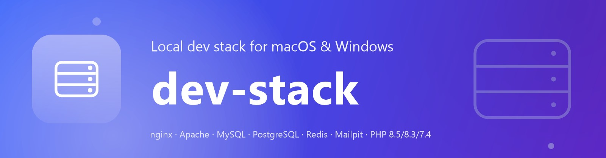
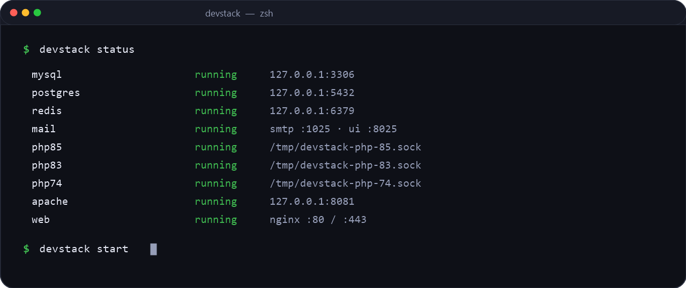
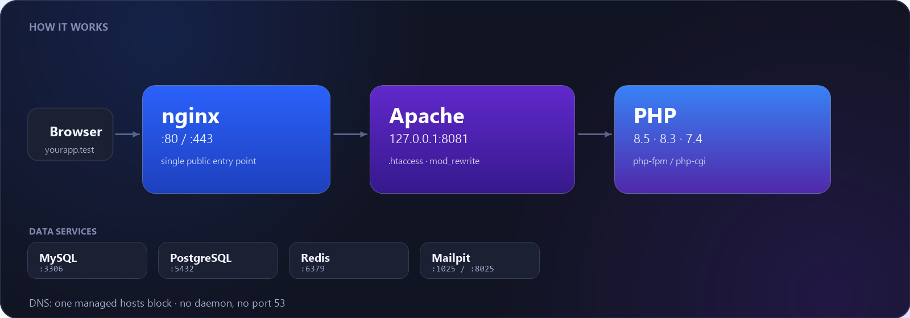
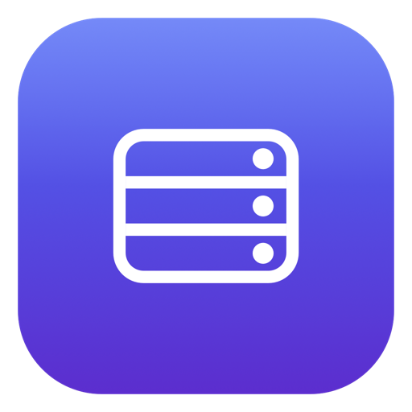

<div align="center">



# dev-stack

**A complete local web-development stack on macOS *and* Windows — one command.**

<sub>nginx · Apache · PHP 8.5 / 8.3 / 7.4 · MySQL · PostgreSQL · Redis · Mailpit</sub><br>
<sub>clean <code>*.test</code> URLs · real <code>.htaccess</code> · trusted HTTPS · a native control app</sub>

<br>

[](#install)
[](#install)
[](https://github.com/itsmeshafat/dev-stack/releases)
[](https://github.com/itsmeshafat/dev-stack/actions/workflows/ci.yml)
[](LICENSE)
[](https://github.com/itsmeshafat/dev-stack/stargazers)
[](https://github.com/itsmeshafat/dev-stack/pulls)

[**Install**](#install) · [Platforms](#platforms) · [How it works](#how-it-works) · [Migrate](#migrating-an-existing-setup) · [Commands](#commands) · [Docs](#documentation) · [Safety](#safety)

<sub><b>9 services</b> · <b>3 PHP versions</b> · <b>1 command</b> · <b>0 DNS daemons</b> · <b>0 containers</b></sub>

</div>

---

> **No containers, no VMs, no DNS daemon.** dev-stack wires plain Homebrew (macOS) or Scoop (Windows)
> services together on your real filesystem: nginx in front of Apache for genuine `.htaccess` support,
> php-fpm/php-cgi behind it, per-site PHP versions, clean `*.test` URLs, trusted TLS, and a native app to
> start/stop everything.

<div align="center">
<table>
<tr>
<td width="50%"><br><sub><b>macOS</b> — SwiftUI app</sub></td>
<td width="50%"><br><sub><b>Windows</b> — tray app, Start Menu & uninstaller</sub></td>
</tr>
</table>
</div>

## Demo

[](https://www.youtube.com/watch?v=RfeGRdjbGHk)

## At a glance

| | |
|---|---|
| **Platforms** | macOS 12+ (Apple Silicon & Intel) · Windows 10/11 (x64) |
| **Web stack** | nginx `:80`/`:443` → Apache `127.0.0.1:8081` → PHP |
| **PHP** | 8.5, 8.3 and 7.4 side by side — chosen per site |
| **Data** | MySQL 8.4 · PostgreSQL 18 · Redis · Mailpit (SMTP + UI) |
| **URLs** | `yourapp.test` on one port, generated from one `sites.conf` |
| **TLS** | mkcert wildcard `*.test`, `http://` → `https://` |
| **DNS** | one managed hosts block — no dnsmasq, nothing on port 53 |
| **Control app** | SwiftUI (macOS) · WinForms + system tray (Windows) |
| **Updates** | verified, atomic, rollback — never touches your data |
| **License** | MIT |

<div align="center">
  
  <br>
  <sub><code>devstack status</code> - every module, live.</sub>
</div>

## Why dev-stack

| | |
|---|---|
| 🌐 **Clean URLs on one port** | Every site answers at `yourapp.test` on `:80` — no `:8000`, no `localhost/path`. |
| 🧩 **Real Apache underneath** | nginx proxies to loopback Apache, so `.htaccess` and `mod_rewrite` behave exactly as in production. |
| 🐘 **Three PHP versions, side by side** | 8.5, 8.3 and 7.4 — each site picks its own, and `devstack composer` uses it too. |
| 🚫 **No DNS daemon** | `*.test` names live in one generated hosts block. No dnsmasq, no port 53, survives reboots. |
| 🖥️ **Native control app** | Start/stop/restart with live status. On Windows it lives in the notification area. |
| 🔒 **Trusted HTTPS** | One wildcard `*.test` certificate via mkcert; Laravel `APP_URL` / WordPress `siteurl` sync automatically. |
| 🛟 **Safe by design** | `--dry-run`/`-DryRun`, backups before changes, idempotent install, clean uninstall. |
| 📦 **Data never lost** | Reinstall/uninstall keep `sites.conf`, settings and databases; `-Purge` only when you ask. |
| 🔀 **Bring existing work** | Import sites from XAMPP/WAMP/Laragon/Herd and import `mysqldump`/`pg_dump` files. |

## Install

<table>
<tr><td width="50%" valign="top">

**macOS**

```bash
git clone https://github.com/itsmeshafat/dev-stack.git
cd dev-stack

./install.sh --dry-run   # print every action, change nothing
./install.sh             # install (one admin prompt)
```

</td><td width="50%" valign="top">

**Windows** (PowerShell)

```powershell
git clone https://github.com/itsmeshafat/dev-stack.git
cd dev-stack

powershell -File windows\install.ps1 -DryRun
powershell -File windows\install.ps1
```

</td></tr>
</table>

Then point the stack at a project with one line:

```ini
# ~/.config/devstack/sites.conf   (or %USERPROFILE%\.config\devstack\sites.conf)
myapp.test | ~/Sites/myapp/public | 8.5 | laravel
```

```bash
devstack add-site     # or edit the file above
devstack sync         # regenerate vhosts + hosts, reload
devstack doctor       # verify services, configs, sites
devstack start        # bring the stack up
```

Prebuilt releases (including the compiled Windows `DevStack.exe`) are on the
[releases page](https://github.com/itsmeshafat/dev-stack/releases).

## Platforms

One tool, two first-class implementations. The `devstack` command surface and `sites.conf` format are
identical on both, so a configuration moves between machines.

| | **macOS** | **Windows 10/11 (x64)** |
|---|---|---|
| Entry point | `install.sh` + `bin/devstack` (bash) | `windows\install.ps1` + `devstack` (PowerShell) |
| Package manager | Homebrew | Scoop (automatic Apache Lounge fallback) |
| PHP | **php-fpm** over unix sockets | **php-cgi** FastCGI via `mod_fcgid` |
| Privileges | one scoped `NOPASSWD` helper (nginx + hosts) | one scheduled task (hosts only) |
| App | SwiftUI (`.app`) | WinForms `.exe` + tray, Start Menu, uninstaller |
| Updates | verified swap + rollback | out-of-process swap + rollback |

## How it works

<div align="center">
  
</div>

Browser -> nginx (`:80` / `:443`) -> Apache (`127.0.0.1:8081`, `.htaccess`) -> PHP (`php-fpm` on macOS,
`php-cgi` on Windows). Data services run alongside, and `*.test` resolves through one managed hosts block.

nginx is the **single public entry point**. Apache binds to **loopback only**, so nothing is exposed
beyond your machine. Full details: [`docs/ARCHITECTURE.md`](docs/ARCHITECTURE.md) ·
[`windows/docs/ARCHITECTURE.md`](windows/docs/ARCHITECTURE.md).

## Migrating an existing setup

```bash
devstack migrate                  # read-only scan of XAMPP / WAMP / Laragon / Herd
devstack migrate --apply          # add the sites it finds (nothing is moved or copied)
devstack sync
```

Databases move separately — stop the old server first (both stacks use the same ports):

```bash
mysqldump -u root --all-databases > backup.sql
devstack migrate db backup.sql                    # into dev-stack MySQL

pg_dumpall -U postgres > backup.sql
devstack migrate db backup.sql --engine pgsql     # into dev-stack PostgreSQL
```

## PHP versions

- **Per site** — set the `php` column and apply:
  ```ini
  myapp.test | ~/Sites/myapp/public | 8.3 | laravel
  ```
  ```bash
  devstack sync
  ```
- **Command line** — choose what `php` and Composer use:
  ```bash
  devstack php status
  devstack php default 8.3     # or 7.4 / 8.5
  ```
  Open a new terminal afterwards. `devstack composer` always uses the site's declared PHP.

## Commands

The same commands exist on both platforms (`devstack` in bash or PowerShell):

| Command | What it does |
|---|---|
| `devstack status` | every module and its state |
| `devstack start \| stop \| restart [module]` | control all modules, or one |
| `devstack sites` / `add-site` | list / add sites |
| `devstack sync` | regenerate vhosts + hosts, reload servers |
| `devstack ssl {enable\|disable\|status\|renew}` | trusted HTTPS for all sites |
| `devstack php [status\|list\|default V]` | default PHP for the CLI |
| `devstack migrate [--apply]` | import sites from XAMPP/WAMP/Laragon/Herd |
| `devstack migrate db FILE` | import a `mysqldump` / `pg_dump` |
| `devstack phpmyadmin [status\|install]` | optional phpMyAdmin at `https://phpmyadmin.test` |
| `devstack composer [--site H \| --php V] …` | run Composer with a site's PHP |
| `devstack update [--check\|--rollback]` | check for / apply a release |
| `devstack doctor` | verify services, configs, hosts, every site |

<details>
<summary><b>Configuration &amp; file locations</b></summary>

<br>

- **Sites** — `~/.config/devstack/sites.conf` · `%USERPROFILE%\.config\devstack\sites.conf`
  (`host | docroot | php | kind | aliases`)
- **Settings** — `~/.config/devstack/config` · `%USERPROFILE%\.config\devstack\config`
- **Data / logs / backups / certs** — `~/.local/share/devstack/` · `%LOCALAPPDATA%\devstack\`
- **Ports** — override `NGINX_PORT`, `APACHE_PORT`, `SSL_PORT` in `config`

</details>

<details>
<summary><b>Updates &amp; data safety</b></summary>

<br>

`devstack update` checks the latest release, verifies the archive version, and swaps only the
application (out-of-process on Windows) while keeping the previous versions for `--rollback`. It never
touches `sites.conf`, settings, certificates, hosts, vhosts, databases or running services.

Reinstalling and uninstalling **keep** your sites, settings and database data. On Windows, add `-Purge`
to delete config and databases too. Like macOS, dev-stack never backs up your databases — keep your own
`mysqldump` / `pg_dump` dumps.

</details>

## Safety

- `--dry-run` / `-DryRun` prints every action and changes nothing.
- Configs are backed up before any change; the hosts file gets a safety copy before each edit.
- The only privileged surface is nginx + the hosts block (macOS: one scoped helper; Windows: one scheduled
  task). Apache binds to loopback only.
- Clean removal restores what it changed and stops every service.
- **Provided as-is, without warranty.** It does **not** back up databases or project files.

Read more: [`docs/SAFETY.md`](docs/SAFETY.md) · [`windows/docs/SAFETY.md`](windows/docs/SAFETY.md) ·
[`SECURITY.md`](SECURITY.md) · [`windows/docs/SECURITY.md`](windows/docs/SECURITY.md).

## Documentation

| Document | Contents |
|---|---|
| [`docs/INSTALL.md`](docs/INSTALL.md) | macOS install, flags, troubleshooting |
| [`windows/docs/INSTALL.md`](windows/docs/INSTALL.md) | Windows install, Scoop/Chocolatey, troubleshooting |
| [`docs/DATABASES.md`](docs/DATABASES.md) · [`windows/docs/DATABASES.md`](windows/docs/DATABASES.md) | database cookbook per platform |
| [`docs/HELP.md`](docs/HELP.md) · [`windows/docs/HELP.md`](windows/docs/HELP.md) | in-app help guides |
| [`docs/ARCHITECTURE.md`](docs/ARCHITECTURE.md) · [`windows/docs/ARCHITECTURE.md`](windows/docs/ARCHITECTURE.md) | how the pieces fit together |
| [`docs/SAFETY.md`](docs/SAFETY.md) · [`windows/docs/SAFETY.md`](windows/docs/SAFETY.md) | exactly what it touches |
| [`docs/NOTICE.md`](docs/NOTICE.md) · [`windows/docs/NOTICE.md`](windows/docs/NOTICE.md) | licensing & originality |
| [`CHANGELOG.md`](CHANGELOG.md) | release history |

## Contributing

Issues and pull requests are welcome.

- Run `./install.sh --dry-run` and `scripts/smoke-test.sh` (macOS) or
  `powershell -File windows\install.ps1 -DryRun` (Windows) before opening a PR.
- CI lints shell (`shellcheck`), parses with bash 3.2, runs PSScriptAnalyzer, builds both apps, and runs
  the installer dry-runs.
- Docs are the single source for the in-app Help (macOS renders `docs/HELP.md`, Windows packages
  `windows/docs/HELP.md`).

## Support

If dev-stack saves you time: **♥ [Donate](https://www.itsmeshafat.com/donate)** — GitHub also shows a
**Sponsor** button (via [`.github/FUNDING.yml`](.github/FUNDING.yml)).

## License & disclaimer

[MIT](LICENSE). Provided **“as is”**, without warranty of any kind, express or implied — you use it at
your own risk. The authors are not liable for data loss or service interruption. Take your own database
dumps and keep projects under version control.

<div align="center">
<br>

<br>
<sub><b>dev-stack</b> — a Mac and a PC that run everything.</sub>
</div>
