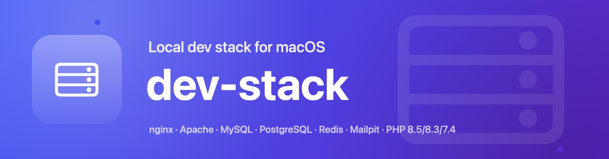
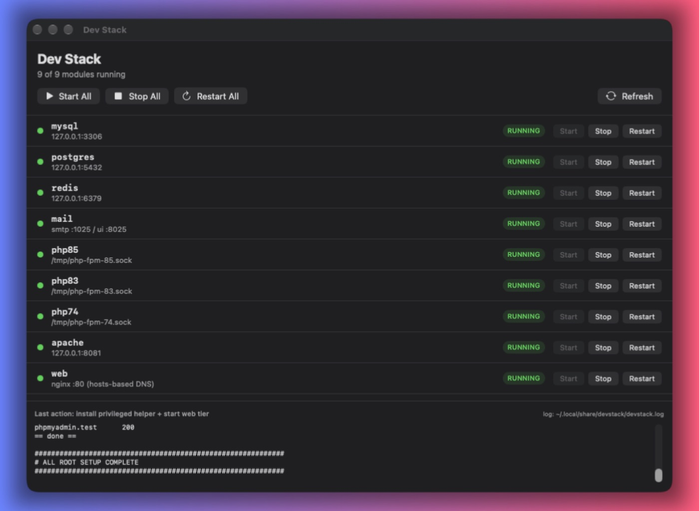

<p align="center">
  
</p>

<h1 align="center">dev-stack</h1>

<p align="center">
  <b>nginx · Apache · PHP-FPM · MySQL · PostgreSQL · Redis · Mailpit</b><br>
  <sub>One command to run a complete local development stack on macOS — clean <code>*.test</code> URLs, real <code>.htaccess</code>, and a native control app.</sub>
</p>

<p align="center">
  <a href="#install"></a>
  <a href="#requirements"></a>
  
  <a href="LICENSE"></a>
  
</p>

<p align="center">
  <a href="#why-dev-stack">Why</a> ·
  <a href="#install">Install</a> ·
  <a href="#how-it-works">How it works</a> ·
  <a href="#configuration">Configuration</a> ·
  <a href="#commands">Commands</a> ·
  <a href="#safety">Safety</a> ·
  <a href="#docs">Docs</a>
</p>

---

<p align="center">
  
  <br>
  <sub><b>The control app</b> — start or stop the whole stack, or any single module, with live status.</sub>
</p>

## Why dev-stack

| | |
|---|---|
| 🌐 **One public port, clean URLs** | Everything is served at `yourapp.test` on `:80` — no `:8000`, no `localhost/path`. |
| 🧩 **Real Apache underneath** | nginx fronts [Apache](https://httpd.apache.org) on `127.0.0.1:8081`, so `.htaccess` and `mod_rewrite` behave natively. |
| 🐘 **Multiple PHP versions** | 8.5, 8.3 and 7.4 side by side — each site selects its own via `php-fpm` sockets. |
| 🚫 **DNS with no daemon** | `*.test` names live in a managed `/etc/hosts` block, regenerated from your vhosts. No dnsmasq, no port 53. |
| 🖥️ **Native control app** | A SwiftUI app to start/stop/restart everything and watch live status. |
| 🛟 **Safe by design** | `--dry-run`, automatic backups, idempotent install, and a clean uninstall. |

## Requirements

| | |
|---|---|
| **macOS** | 12 or newer · Apple Silicon or Intel |
| **Homebrew** | required — the installer offers to install it |
| **Xcode CLT** | only to build the GUI app → `xcode-select --install` |

## Install

> This repository is **private**, so a raw `curl | bash` won't work — clone with auth.

```bash
gh repo clone itsmeshafat/dev-stack
cd dev-stack

./install.sh --dry-run     # print every action, change nothing
./install.sh               # install (asks for your password once — scoped helper)
```

Then define your sites and bring the stack up:

```bash
$EDITOR ~/.config/devstack/sites.conf    # host | docroot | php | kind
devstack restart web
devstack doctor
```

Prefer clicking? Open **Dev Stack** in `/Applications` → **Start All**.

## How it works

```text
                    ┌──────────── yourapp.test :80 ────────────┐
     browser ──────▶│ nginx  ($HOMEBREW_PREFIX/etc/nginx)      │
                    │   servers/<host>.conf → proxy_pass :8081 │
                    └────────────────────┬─────────────────────┘
                                         ▼
                    ┌────── Apache 127.0.0.1:8081 ─────────────┐
                    │ httpd/vhosts/<host>.conf                 │
                    │   AllowOverride All  → .htaccess/mod_rewrite
                    │   <FilesMatch \.php$> → proxy:unix:…      │
                    └────────────────────┬─────────────────────┘
                                         ▼
          /tmp/devstack-php-85.sock · -83.sock · -74.sock

  data   mysql@8.4 :3306 · postgresql@18 :5432 · redis :6379 · mailpit :1025/:8025
  DNS    /etc/hosts  →  127.0.0.1 <host>   (generated from nginx vhosts)
```

Apache is bound to **loopback only** — nothing is exposed beyond your machine. nginx is the single public entry point.

<details>
<summary><b>Modules</b></summary>

<br>

| module | service | endpoint |
|---|---|---|
| `mysql` | `mysql@8.4` | `127.0.0.1:3306` |
| `postgres` | `postgresql@18` | `127.0.0.1:5432` |
| `redis` | `redis` | `127.0.0.1:6379` |
| `mail` | `mailpit` | SMTP `:1025` · UI `:8025` |
| `php85` | `php` | `/tmp/devstack-php-85.sock` |
| `php83` | `php@8.3` | `/tmp/devstack-php-83.sock` |
| `php74` | `php@7.4` | `/tmp/devstack-php-74.sock` |
| `apache` | `httpd` | `127.0.0.1:8081` |
| `web` | `nginx` | `:80` |

</details>

> **Tooling** — alongside the services, the installer provisions **`composer`** and **`wp-cli`**.
> When a project pins an older PHP, run Composer with that PHP:
> `/opt/homebrew/opt/php@8.3/bin/php "$(command -v composer)" install`

## Configuration

**`~/.config/devstack/sites.conf`** — one site per line (`|` separated; `kind` and `aliases` optional):

```ini
# host            | docroot                              | php | kind    | aliases
casepilot.test    | ~/Developer/CasePilot                | 8.3 | laravel
jd-blog.test      | ~/Developer/jd-blog/public           | 8.5 | php
wptest.test       | ~/Sites/wptest                       | 8.5 | wp
myapp.test        | ~/Sites/myapp                        | 8.5 | laravel | www.myapp.test
```

> Tip: use `public/` as the docroot for stock Laravel. If an app ships a root `.htaccess` that forwards into `public/`, point the docroot at the project root instead.

**`~/.config/devstack/config`** (optional) — override defaults:

```ini
NGINX_PORT=80
APACHE_PORT=8081
```

## Commands

| Command | What it does |
|---|---|
| `devstack status` | Show every module and its state |
| `devstack start \| stop \| restart [module]` | Control all modules, or one |
| `devstack sites` | List configured sites |
| `devstack add-site` | Add a site interactively |
| `devstack sync` | Regenerate vhosts and reload nginx + Apache |
| `devstack doctor` | Verify formulae, services, configs, helper, and every site |

## Safety

- **`--dry-run`** prints every action and changes nothing.
- **Backups first** — `/etc/hosts`, nginx/apache configs and each `php-fpm.d/www.conf` are copied to
  `~/.local/share/devstack/backups/<timestamp>/` before any change.
- **Idempotent** — re-running the installer reconciles, it doesn’t duplicate.
- **Least privilege** — the only privileged surface is one helper script (restart nginx + rewrite the hosts
  block) behind a single `NOPASSWD` rule. No general `sudo`.
- **Clean removal** — `./uninstall.sh` stops services, removes the helper, restores backups.

<details>
<summary><b>Troubleshooting</b></summary>

<br>

| Symptom | Fix |
|---|---|
| `devstack: command not found` | add `~/.local/bin` to `PATH` |
| site returns **502** | Apache isn’t running → `devstack start apache` |
| works on `:8081` but **404** on `:80` | stale nginx vhosts → `devstack sync` |
| site doesn’t resolve | hosts block missing → `devstack restart web` |
| PHP version wrong for a site | check the `php` column, then `devstack sync` |
| helper button does nothing | `sudo bash bin/install-helper-root "$USER" "$PWD"` |

More in [`docs/INSTALL.md`](docs/INSTALL.md).

</details>

## Docs

- [`docs/INSTALL.md`](docs/INSTALL.md) — install, flags, troubleshooting
- [`docs/ARCHITECTURE.md`](docs/ARCHITECTURE.md) — how the pieces fit
- [`docs/SAFETY.md`](docs/SAFETY.md) — exactly what it touches on your machine

## License

MIT — see [LICENSE](LICENSE).

<p align="center">
  <sub>Built for a Mac that runs everything. ⚡</sub>
</p>
