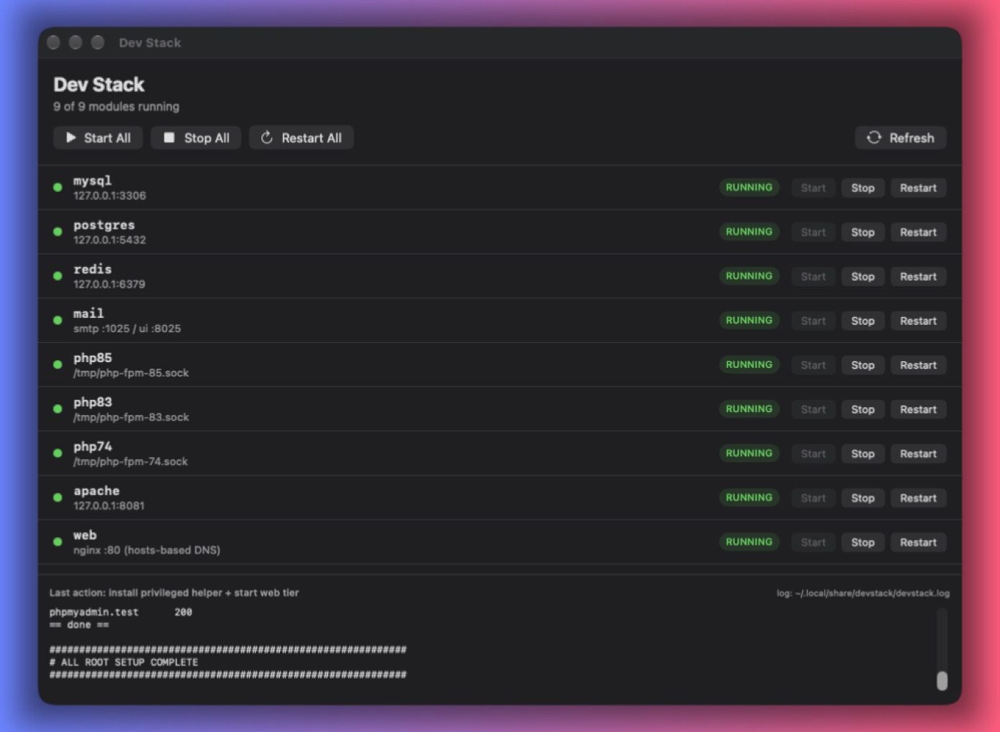
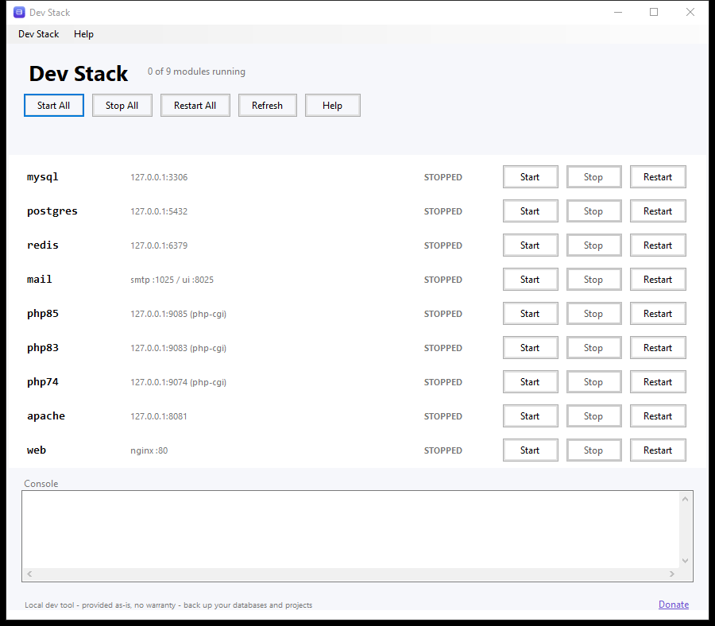

<p align="center">
  
</p>

<p align="center">
  <sub><b>nginx · Apache · PHP · MySQL · PostgreSQL · Redis · Mailpit</b> on macOS <i>and</i> Windows —<br>
  clean <code>*.test</code> URLs, real <code>.htaccess</code>, trusted HTTPS and a native control app.</sub>
</p>

<p align="center">
  <a href="#install"></a>
  
  <a href="https://brew.sh"></a>
  <a href="https://scoop.sh"></a>
  <a href="https://github.com/itsmeshafat/dev-stack/releases"></a>
  <a href="https://github.com/itsmeshafat/dev-stack/actions/workflows/ci.yml"></a>
  <a href="LICENSE"></a>
</p>

<p align="center">
  <a href="#install"><b>Install</b></a> &nbsp;·&nbsp;
  <a href="#platforms">Platforms</a> &nbsp;·&nbsp;
  <a href="#how-it-works">How it works</a> &nbsp;·&nbsp;
  <a href="#configuration">Configuration</a> &nbsp;·&nbsp;
  <a href="#migrating-an-existing-setup">Migrate</a> &nbsp;·&nbsp;
  <a href="#commands">Commands</a> &nbsp;·&nbsp;
  <a href="#safety">Safety</a> &nbsp;·&nbsp;
  <a href="CHANGELOG.md">Changelog</a>
</p>

<p align="center">
  <sub><b>9 services</b> &nbsp;·&nbsp; <b>3 PHP versions</b> &nbsp;·&nbsp; <b>1 command</b> &nbsp;·&nbsp; <b>0 DNS daemons</b> &nbsp;·&nbsp; <b>0 containers</b></sub>
</p>

---

## Platforms

dev-stack is one tool with two first-class implementations and per-platform releases. The command surface
and `sites.conf` format are the same on both, so a configuration moves between machines.

| | **macOS** | **Windows 10/11 (x64)** |
|---|---|---|
| Entry point | `./install.sh` + `bin/devstack` (bash) | `windows\install.ps1` + `devstack` (PowerShell) |
| Web topology | nginx :80/:443 → Apache :8081 → **PHP-FPM** unix sockets | nginx :80/:443 → Apache :8081 → **php-cgi** (FastCGI, `mod_fcgid`) |
| Packages | Homebrew | Scoop (Apache Lounge fallback) |
| Control app | SwiftUI (macOS) | Windows Forms — Start Menu, Apps & features, **system tray** |
| DNS | managed `/etc/hosts` block | managed hosts block via a scoped scheduled task |
| HTTPS | mkcert wildcard `*.test` | mkcert wildcard `*.test` |

<p align="center">
  
  
  <br>
  <sub><b>macOS</b> (SwiftUI) &nbsp;·&nbsp; <b>Windows</b> (with tray, Start Menu and uninstaller)</sub>
</p>

## Why dev-stack

|  |  |
|---|---|
| 🌐 **Clean URLs on one port** | Every site answers at `yourapp.test` on `:80` — no `:8000`, no `localhost/path`. |
| 🧩 **Real Apache underneath** | nginx fronts Apache on loopback, so `.htaccess` and `mod_rewrite` behave exactly as in production. |
| 🐘 **Three PHP versions, side by side** | 8.5, 8.3 and 7.4 — each site picks its own. |
| 🚫 **No DNS daemon** | `*.test` names live in one managed hosts block, regenerated from your vhosts. |
| 🖥️ **Native control app** | Start/stop/restart with live status. On Windows it lives in the **notification area**. |
| 🔒 **Trusted HTTPS** | One wildcard `*.test` certificate via mkcert; `http://` 301s to `https://`. |
| 🛟 **Safe by design** | `--dry-run`/`-DryRun`, automatic config backups, idempotent installer, clean uninstaller. |
| 📦 **Migration & data safety** | Import sites from XAMPP/WAMP/Laragon/Herd; reinstall/uninstall keeps config and databases. |

## Install

**macOS**
```bash
git clone https://github.com/itsmeshafat/dev-stack.git
cd dev-stack
./install.sh --dry-run     # prints every action, changes nothing
./install.sh
```

**Windows** (PowerShell)
```powershell
git clone https://github.com/itsmeshafat/dev-stack.git
cd dev-stack
powershell -File windows\install.ps1 -DryRun
powershell -File windows\install.ps1
```

Then add a site with one line (`~/Sites/myapp` / `C:\Sites\myapp`) and apply:
```bash
devstack add-site     # or edit ~/.config/devstack/sites.conf / %USERPROFILE%\.config\devstack\sites.conf
devstack sync
devstack doctor
```
Releases are published per platform on the [releases page](https://github.com/itsmeshafat/dev-stack/releases);
the Windows asset includes the compiled `DevStack.exe`.

## How it works

```text
browser → nginx :80/:443 → Apache 127.0.0.1:8081 → PHP
                                                   macOS:   php-fpm  /tmp/devstack-php-8x.sock
                                                   Windows: php-cgi  127.0.0.1:9085/9083/9074 (mod_fcgid)
data: mysql :3306 · postgres :5432 · redis :6379 · mailpit :1025/:8025
DNS:  127.0.0.1 <host> in the managed hosts block (generated from nginx server_name)
```

nginx is the **single public entry point**; Apache binds to **loopback only**. Full details:
[`docs/ARCHITECTURE.md`](docs/ARCHITECTURE.md) · [`windows/docs/ARCHITECTURE.md`](windows/docs/ARCHITECTURE.md).

## Configuration

`sites.conf` — one site per line, `|` separated (`kind` and `aliases` optional):
```ini
# host | docroot | php | kind | aliases
myapp.test | ~/Sites/myapp/public        | 8.5 | laravel
wptest.test | ~/Sites/wptest             | 8.5 | wp
legacy.test | ~/Sites/legacy             | 7.4 | php
```
Paths: macOS `~/.config/devstack/` · Windows `%USERPROFILE%\.config\devstack\`. Data, logs, backups and
certs live under `~/.local/share/devstack/` and `%LOCALAPPDATA%\devstack\`.

## Migrating an existing setup

```bash
devstack migrate                  # read-only scan of XAMPP / WAMP / Laragon / Herd
devstack migrate --apply          # add the sites it finds (nothing is moved)
devstack sync
```
Databases move separately (stop the old server first — both use the same ports):
```bash
mysqldump -u root --all-databases > backup.sql
devstack migrate db backup.sql                       # into MySQL
devstack migrate db backup.sql --engine pgsql        # into PostgreSQL
```

## PHP versions

- **Per site:** set the `php` column and run `devstack sync`.
- **Command line:** `devstack php default 8.3` makes `php`/Composer default to 8.3 (open a new terminal).
  `devstack php status` shows the current choice.

## Commands

Both platforms expose the same `devstack` commands (macOS bash / Windows PowerShell):

| Command | What it does |
|---|---|
| `devstack status` | every module and its state |
| `devstack start \| stop \| restart [module]` | control all modules, or one |
| `devstack sites` / `add-site` | list / add sites |
| `devstack sync` | regenerate vhosts + hosts, reload |
| `devstack ssl {enable\|disable\|status\|renew}` | trusted HTTPS |
| `devstack php [status\|list\|default V]` | default PHP for the CLI |
| `devstack migrate [--apply]` / `migrate db FILE` | import a setup / a database dump |
| `devstack phpmyadmin [status\|install]` | optional phpMyAdmin |
| `devstack composer [--site H \| --php V] ...` | run Composer with a site's PHP |
| `devstack update [--check\|--rollback]` | check for / apply a release |
| `devstack doctor` | verify services, configs, hosts, sites |

## Updates

The app checks for a new release at launch. `devstack update` swaps only the application code and the app
bundle (out-of-process on Windows), keeps the previous versions for `--rollback`, and **never** touches
config, certificates, hosts, databases or running services.

## Safety

- `--dry-run` / `-DryRun` prints every action and changes nothing.
- Configs are backed up before any change; reinstall and uninstall **keep** your `sites.conf`, settings and
  databases (Windows: add `-Purge` to delete them).
- The only privileged surface is nginx + the hosts block (macOS: one `NOPASSWD` helper; Windows: one
  scheduled task). Apache binds to loopback only.
- **No warranty; back up your data** — dev-stack does not back up databases or project files.

Details: [`docs/SAFETY.md`](docs/SAFETY.md) · [`windows/docs/SAFETY.md`](windows/docs/SAFETY.md) ·
[`SECURITY.md`](SECURITY.md) · [`windows/docs/SECURITY.md`](windows/docs/SECURITY.md).

## Docs

| Document | Contents |
|---|---|
| [`docs/INSTALL.md`](docs/INSTALL.md) | macOS install, flags, troubleshooting |
| [`windows/docs/INSTALL.md`](windows/docs/INSTALL.md) | Windows install, Scoop/Chocolatey, troubleshooting |
| [`docs/DATABASES.md`](docs/DATABASES.md) · [`windows/docs/DATABASES.md`](windows/docs/DATABASES.md) | database cookbook per platform |
| [`docs/HELP.md`](docs/HELP.md) · [`windows/docs/HELP.md`](windows/docs/HELP.md) | in-app guides |
| [`docs/ARCHITECTURE.md`](docs/ARCHITECTURE.md) · [`windows/docs/ARCHITECTURE.md`](windows/docs/ARCHITECTURE.md) | how the pieces fit together |
| [`docs/SAFETY.md`](docs/SAFETY.md) · [`windows/docs/SAFETY.md`](windows/docs/SAFETY.md) | what it touches |
| [`SECURITY.md`](SECURITY.md) | privileged surface, threat model, reporting |
| [`docs/NOTICE.md`](docs/NOTICE.md) · [`windows/docs/NOTICE.md`](windows/docs/NOTICE.md) | licensing & originality |
| [`CHANGELOG.md`](CHANGELOG.md) | release history |

## Support

If dev-stack saves you time: **♥ [Donate](https://www.itsmeshafat.com/donate)**.

## Disclaimer

Provided **“as is”**, without warranty of any kind — see the [MIT License](LICENSE). You use it at your own
risk. It does **not** back up your databases or project files; take your own dumps and keep projects under
version control.

## License

MIT — see [LICENSE](LICENSE).

<p align="center">
  <br>
  
  <br>
  <sub><b>dev-stack</b> — built for a Mac and a PC that run everything.</sub>
</p>
